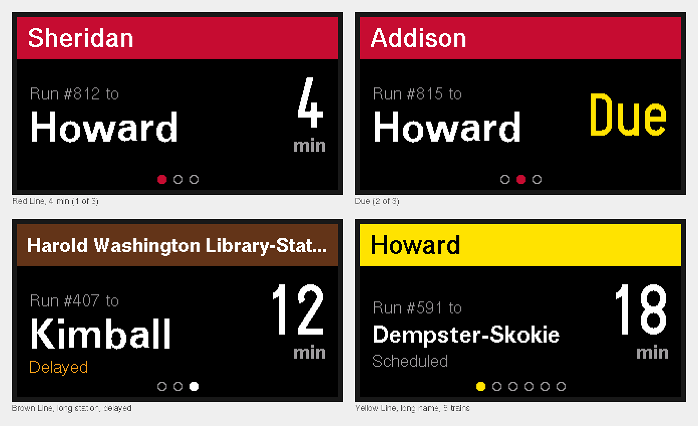

# Stoop

A small desk display that shows upcoming CTA 'L' train arrivals for your stop. It runs on a
Waveshare ESP32-C6-LCD-1.47 board and is set up entirely from your phone or browser.



## Features

- **Live arrivals** from the [CTA Train Tracker API](https://www.transitchicago.com/developers/ttdocs/).
  Shows the next 1–6 trains, one at a time, rotating every 6 seconds.
- **Status flags**: "Due", "Delayed" and "Scheduled" (no live tracking), with the header
  colored to match the line.
- **Wi-Fi captive portal**: on first boot the device opens its own access point so you can
  pick a network. There is no hardcoded SSID or password.
- **Web UI** at `http://stoop.local/` to choose the line, station and direction, set
  your API key, set how many trains to show, and change Wi-Fi.
- **Sample-data build** that cycles through canned arrivals, so you can work on the display
  without a network or an API key.

## Hardware

- [Waveshare ESP32-C6-LCD-1.47](https://docs.waveshare.com/ESP32-C6-LCD-1.47): ESP32-C6, 4 MB
  flash, 1.47" 172×320 ST7789 LCD (used in landscape).
- A USB-C cable. The board has no USB-UART chip, so flashing and serial both use the C6's
  native USB.

The pin map is in [src/board.h](src/board.h).

## Getting started

### 1. Build and flash

Install [PlatformIO](https://platformio.org/) (CLI or the VS Code extension), then:

```sh
pio run -t upload        # build and flash
pio device monitor       # serial log at 115200 baud
```

### 2. Connect to Wi-Fi

1. On first boot the screen shows **Wi-Fi setup** and the device starts an open network
   named `stoop-XXXX`.
2. Join it from your phone. The captive portal should open on its own; if it doesn't, go to
   `http://192.168.4.1/`.
3. Pick your network, enter the password, and save. The device restarts and joins it.

If the connection fails, the setup network comes back.

### 3. Set up the train tracker

1. Get a free API key from the [CTA developer center](https://www.transitchicago.com/developers/).
2. Open `http://stoop.local/trains` (or the device's IP address, printed in the serial log).
3. Enter the key, pick a line, station and direction, and choose how many trains to show.

## Try it without hardware or an API key

**Sample-data firmware.** This build skips Wi-Fi and steps through a new scenario of canned
arrivals on each poll (data in [src/apps/train_sample_data.cpp](src/apps/train_sample_data.cpp)):

```sh
pio run -e esp32-c6-sample -t upload
```

**Screen preview on your computer.** This renders PNGs of the arrival screen using the same
U8g2 fonts as the firmware. Run `pio run` once first so the fonts are downloaded:

```sh
python3 tools/preview_screen.py docs/screen_preview.png
```

The preview script copies the layout math in
[src/apps/train_tracker.cpp](src/apps/train_tracker.cpp). If you change the layout in one,
change it in the other too.

## Resetting

- **Forget Wi-Fi**: hold the **RST** button for 3 seconds right after reset, or use
  **Forget network** on the `/wifi` page. The device restarts into setup mode.
- The train settings and API key are kept on the device until you change them at `/trains`.

## Project layout

```
src/
  main.cpp                 boot sequence, home page, main loop
  board.h                  pin map
  display.*                320x172 framebuffer, text helpers, status screens
  wifi_provisioning.*      saved credentials, captive portal, /wifi page
  web_ui.h                 shared HTML page template and escaping
  apps/
    trains.*               train settings (stored on the device) and the /trains page
    train_api.*            CTA Train Tracker client (HTTPS + ArduinoJson)
    train_tracker.*        background fetch task and the arrival screen
    train_sample_data.*    canned arrivals for the sample build
    train_stops_data.h     generated list of lines, stations and platforms
tools/
  gen_train_stops.py       regenerates train_stops_data.h
  preview_screen.py        renders the arrival screen to a PNG
```

### Updating the station list

[src/apps/train_stops_data.h](src/apps/train_stops_data.h) is generated from the City of
Chicago's [list of 'L' stops](https://data.cityofchicago.org/d/8pix-ypme). Regenerate it when
CTA adds or renames stations:

```sh
python3 tools/gen_train_stops.py             # download the latest data
python3 tools/gen_train_stops.py stops.json  # or use a local copy
```

## Libraries

- [GFX Library for Arduino](https://github.com/moononournation/Arduino_GFX): display driver
- [ArduinoJson](https://arduinojson.org/): parses API responses
- [U8g2](https://github.com/olikraus/u8g2): fonts only, drawn through GFX Library

## Roadmap

- Bus arrivals (CTA Bus Tracker).
- Weather display.

## Notes

This project is not affiliated with or endorsed by the Chicago Transit Authority. Arrival data
comes from the CTA Train Tracker API and is subject to
[CTA's developer terms](https://www.transitchicago.com/developers/).
